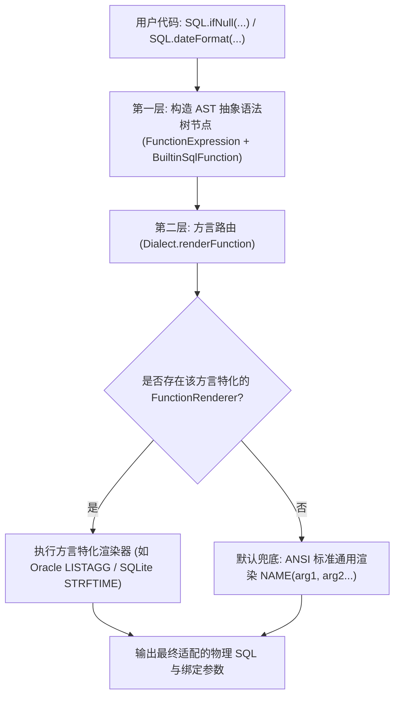

# Java-ORM：现代无 APT 字段感知与级联流式 ORM

[](#)
[](#)
[](LICENSE)
[](#)

> **Java-ORM** 是一个面向 Java 8+ 的轻量级现代关系型数据库 ORM 框架。
> 它借鉴了 **Easy-Query** 的设计哲学，但**彻底摒弃了编译期 APT（代码生成器）技术**。
> 通过基于 **ByteBuddy 的运行时代理调用录制（Invocation Recording）**，实现了类似 `s.getTeacher().getAge()` 的多级级联字段感知、编译期类型安全与纯粹的 SQL 链式流，实体保持纯净 POJO。

> [!WARNING]
> **项目状态声明（Project Status）**
> 本项目当前处于 **Demo 概念验证与技术架构探索阶段（Preview / Experimental）**，**尚未正式上线大规模生产环境（Production）**。
> 当前版本主要用于展示无 APT 运行时代理调用录制与现代流式 SQL 设计理念。欢迎各位开发者交流、体验、提出 Issue / PR 共同探讨；如需在生产环境使用，请务必经过充分的场景评估与完备的自动化回归测试。

---

## 核心特性一览

- 🌟 **SqlEnv 声明式全功能环境模式（首推核心模式）**：
  通过 `orm.sql(e -> { ... })` 开启强类型、显式受控的 SQL 环境。显式声明表变量与别名（如 `e.table(Student.class, "s")`），彻底终结多表联查别名冲突；原生支持同表自连接（Self Join）、复杂多表 JOIN、全量字段/聚合函数计算与任意 DTO 投影映射；内置流式条件 UPDATE 与 DELETE；线程级安全隔离，执行完毕自动清理上下文，零污染、零泄漏。
- ⚡ **高性能批量操作引擎（Batch Engine，参考 EasyQuery）**：
  原生支持 `insertBatch`、`updateBatch`、`deleteBatch`、`deleteByIds`，支持 `batchSize(n)` 批量分块分批，支持多值 VALUES 批量构造与 JDBC `addBatch()` 双模式，自动识别并分发到对应物理分库分表节点，支持主键安全回填与批量乐观锁。
- 🏗️ **智能 Code-First 结构同步与索引引擎（参考 EasyQuery / JPA）**：
  支持实体驱动数据库架构自进化。系统自动反射或包扫描实体元数据，智能比对目标数据库元数据，**自动生成并执行建表 DDL（CREATE TABLE）、增量列补齐（ALTER TABLE ... ADD COLUMN ...）以及物理索引的自动创建（CREATE [UNIQUE] INDEX）**。提供 `CodeFirstMode` 细粒度控制（`NONE`, `VALIDATE`, `CREATE_ONLY`, `UPDATE`, `DROP_CREATE`），提供基于位运算的 `CodeFirstAlterMode` 已有表与索引安全保护（`INDEX`, `LENGTH_EXPAND`, `SAFE` 等），支持跨方言 DDL（MySQL, PostgreSQL, H2, SQLite, Oracle 等），严格遵循安全生产原则。
- 🌉 **MyBatis-Plus 一站式完整适配器（MyBatisPlusAdapter）**：
  在应用启动时（如 Spring Boot 配置类中）仅需配置一次 `MyBatisPlusAdapter.create(sqlSessionFactory)`，即可无缝继承 MyBatis-Plus 的所有能力（自动挂载 `MetaObjectHandler` 插入/更新审计填充、动态表名、多租户行级隔离、防全表更新删除 BlockAttack 插件、Spring 声明式事务、枚举转换、分页插件与注解），后续业务代码 **100% 仅使用纯粹的 JavaORM**，无需再写 Mapper XML 或 BaseMapper！
- 🛡️ **多级乐观锁机制（Optimistic Locking）**：
  原生支持 `@JoVersion`，通过桥接同时支持 MyBatis-Plus `@Version` 与 EasyQuery `@Version`。更新时自动带上 `WHERE version = ?` 并递增 `version + 1`，并发冲突自动抛出强类型 `OptimisticLockException`。
- 🎯 **实体快照与变脏检测（Dirty Checking / 差异增量更新）**：
  基于纯物理内存地址（`IdentityWeakKey`）与 `ReferenceQueue` 实现的高性能非侵入式变更追踪。查询时通过 `.tracking()` 或全局 `autoTrack(true)` 拍摄初始状态快照；更新时智能比对真实变脏字段，**仅将发生实质变更的列加入 UPDATE SET 子句**；未变脏时**直接跳过网络 I/O 与 SQL 执行**（避免无效数据库交互与假性版本号递增）；与 `@JoVersion` 乐观锁无缝协同；内存随 GC 自动回收，彻底根绝内存泄露与实体重写 `equals/hashCode` 导致的状态冲突。
- 🔄 **轻量级读写分离路由器（MasterSlaveRouter & 抗主从延迟）**：
  一主多从极简配置，内置平滑加权轮询（Weighted Round-Robin）负载均衡与容灾软降级；事务环境读操作 100% 自动锁定 Master 主库；**独创写后粘性时间窗口（Pin Master After Write）**，彻底消除“刚写完立刻查”的主从同步复制延迟痛点；支持流式 API（`.useMaster()` / `.useSlave()`）微观精准控制。
- ⚡ **Baomidou dynamic-datasource 动态多数据源无感桥接（@DS 深度感知）**：
  引入 `java-orm-bridge` 后，自动无感感知 Spring 环境下通过 `@DS("slave_1")` 或 `DynamicDataSourceContextHolder` 切换的数据源名称，无缝调度物理数据源，让现有 MyBatis-Plus 动态多数据源生态零成本迁移。
- 📝 **通用元数据自动填充（AutoFillHandler & MetaObjectHandler 桥接）**：
  提供原生的 `AutoFillHandler` 接口与 `@JoAutoFill`（支持 `INSERT`, `UPDATE`, `INSERT_UPDATE`），在插入与更新时自动触发租户、创建人、更新人、时间戳等审计字段填充；通过 SPI 深度桥接 MyBatis-Plus 的 `@TableField(fill = FieldFill.xxx)` 与 `MetaObjectHandler`。
- 📄 **通用无侵入分页模式（Zero-Invasive Pagination）**：
  提供统一的 `toPage(pageNum, pageSize)` 入口，支持开箱即用 `PageResult`，支持函数式构造引用（如 `toPage(1, 10, MyCustomVoPage::new)`）零侵入返回业务自定义 Page 对象；通过 SPI 原生无缝适配 MyBatis-Plus 的 `IPage<T>` 实例传参并就地回写返回。
- 🔍 **多框架注解桥接与智能去重合并（java-orm-bridge）**：
  基于 SPI 动态加载外部元数据，核心模块零硬编码。引入桥接包后，自动支持 MyBatis-Plus（`@TableName`, `@TableId`, `@TableField`, `@Version`, `@TableLogic`）、EasyQuery（`@Table`, `@Column`, `@Version`, `@LogicDelete`, `@Index` 等）、JPA（`@Table`, `@Id`, `@Column`, `@Version`, `@Index`）等注解，多注解并存时智能去重合并为一个属性。
- ⚡ **实体级与类级索引管理（@JoIndex / JPA @Index / EasyQuery @Index 桥接）**：
  原生支持 `@JoIndex` / `@JoIndexes`，既可在类级别声明多列复合索引，也可在字段级别声明单列索引/唯一索引（`unique = true`）；通过桥接包原生兼容 JPA `@Table(indexes = { @Index(...) })` 与 EasyQuery `@Index` 注解，由 Code-First 引擎自动探测与按需建索引。
- 🎯 **第三方枚举原生桥接（IEnum & @EnumValue）**：
  自动识别 MyBatis-Plus 的 `IEnum` 接口与 `@EnumValue` 注解，预热静态反射缓存，实现 O(1) 零反射耗时持久化与反序列化。
- 🔍 **SQL 切面与执行拦截器（SqlInterceptor）**：
  支持对所有查询与增删改操作进行 `beforeQuery`、`beforeUpdate`、`afterExecution` 环绕切面监控、SQL 动态改写与慢查询耗时统计，并提供 `MyBatisPlusInterceptorBridge` 无缝桥接 MP 插件生态。
- 🚀 **零 APT 编译依赖**：
  无需在 `pom.xml` 中配置任何 annotation processor，无须生成 `QUser` 或 `UserProxy` 冗余代码，代码随写随测，实体即改即用。
- 🔍 **多级字段感知与 IDE 原生重构**：
  直接写 `s.getTeacher().getAge()` 或 `Student::getAge`，IDE 原生自动补全字段，重命名时全局安全重构。
- 🌊 **扁平流畅的 SQL 条件流**：
  支持 `where().eq([condition, ]column, value)`，自带布尔判断参数，无需繁复的 `if` 拼接。
- 🔗 **智能导航与多表自动 JOIN**：
  在条件或排序列中点号调用外键关联实体属性，框架自动基于外键关系生成对应的 `LEFT JOIN`。
- 📦 **高性能 Split/Batch IN 装配（Include）**：
  一对一/多对一/一对多关系通过 `.include()` 显式批量加载（IN 查询），从根源杜绝 SQL 笛卡尔积膨胀与分页失效问题。
- 🔄 **值转换器体系（ValueConverter）**：
  统一单层转换架构，支持属性级 `@JoColumn(converter = ...)` 以及全局自动匹配 `AutoValueConverter`。
- 🔒 **字段级敏感数据加密（@JoEncrypt）**：
  内置标准 AES-CBC/Base64 加密策略基类，落库自动加密，入库/查询反序列化自动解密。
- 📄 **开箱即用 JSON 字段（@JoJson）**：
  零配置自动通过 SPI 探测 classpath 上的 JSON 库（Jackson、Fastjson2、Gson），保留并解析完整泛型，解决 `List<MyVo>` 反序列化泛型擦除难题。
- 🧩 **DDD 扁平值对象（ValueObject）**：
  实体中通过 `@JoEmbedded` 嵌入值对象，数据库单表平铺展开存储，支持多层嵌套 VO 与优雅 null 回填策略。
- 🌐 **分库分表与多数据源（Unified Sharding）**：
  单一类注解 `@JoSharding` 统辖分库与分表，单一字段注解 `@JoShardingKey` 驱动路由（未标注时自动回退 `@JoId` 主键）；支持单库单表下推与笛卡尔积广播聚合。
- ☕ **向下兼容 Java 8**：
  基线面向 Java 8，无缝向上兼容运行于 Java 11 / 17 / 21 / 25。

---

## 💡 AI 时代的核心价值：为什么 Java-ORM 是为 AI Coding Agent 量身打造的？

在由大模型（LLM）与自主编程智能体（AI Coding Agent，如 Cursor、Claude Code、Devin、Antigravity、Copilot）主导的研发时代，ORM 框架的技术评估标准已经发生质的颠覆：
> **过去人类选 ORM**：比拼的是“人类少敲几次键盘”和“CRUD 模板代码生成插件”。
> **AI 时代选 ORM**：核心价值完全聚焦于两大生死线：**【节省 Token（上下文成本与抗多文件失步）】** 与 **【编译检查（机器自愈的确定性契约）】**。

---

### 一、两大核心价值深度剖析

#### 1. 极致节省 Token：干掉跨文件样板，彻底消除“注意力漂移与失步”
* **传统模式（MyBatis / XML）的 Token 噩梦**：
  让 AI 写一个稍微复杂的多表关联与分页统计，为了保证上下文完整，必须给 Prompt 塞入或让 AI 生成一整套文件：
  `Order.java` + `User.java` + `OrderMapper.java` + `OrderMapper.xml`（包含 `<resultMap>`、`<sql>`、`<select id="...">`、动态 `<if>`、分页标签等）+ `OrderService`。
  - **Prompt 输入 Token 暴增**：动辄占用 5,000 ~ 15,000 Token，极大增加 API 账单成本，并拖慢大模型推理首字延迟（TTFT）。
  - **注意力漂移与跨文件失步（Attention Loss & Desynchronization）**：这是长上下文大模型极易出现的通病——实体属性叫 `createTime`，XML resultMap 映射成 `create_time`，条件 `<if test="createTime != null">` 稍不留神大小写写错，或者手写 SQL 别名不匹配。多个散落文件让 AI 的注意力严重稀释。
  - **输出 Token 减半**：新增或修改一个字段，传统方案 AI 需要同时修改实体、Mapper 接口、XML 映射文件、Service 四处；Java-ORM 仅需在实体上声明一个属性，输出 Token 直降 70%~80%。
* **Java-ORM 的降维打击（实体即元数据，单段纯 Java 业务全内聚）**：
  在 Java-ORM 中，AI 只需要看实体定义，在单个业务方法中通过强类型 `orm.sql(e -> { ... })` 完成表声明、JOIN 关联、WHERE 条件、DTO 投影映射全流程。
  **零多余文件、零 XML 标签、零 Mapper 接口，不仅为开发者节省巨额 API Token 账单，更让 AI 的全部注意力高度聚焦在纯粹的业务逻辑上！**

```java
// AI 编写的代码极其聚焦，单段纯 Java 代码内聚所有业务逻辑，零 XML 样板：
List<OrderVo> orders = orm.sql(e -> {
    Order o = e.table(Order.class, "o");
    User u = e.table(User.class, "u");
    e.select(OrderVo.class, o.getOrderNo(), u.getName(), o.getAmount())
     .from(o)
     .leftJoin(u).on(o.getUserId(), u.getId())
     .where().ge(o.getAmount(), 100);
}).toList();
```

#### 2. 编译检查（强类型确定性）：构建“编译器毫秒级自愈闭环”（Compiler Feedback Loop）
* **传统 SQL / XML 的“沉默杀手”**：
  MyBatis 的 XML 标签、注解中的动态 SQL 字符串、OGNL 表达式对于 Java 编译器（`javac`）而言**全是不透明的无类型黑盒字符串**。
  - 现象：AI 编写完代码，本地执行 `mvn compile` 顺利通过（返回 SUCCESS）；但一旦部署到测试环境或运行时，往往因为 XML 标签闭合错误、字段拼写错误、动态条件语法错而直接抛 `BadSqlGrammarException` 或 `ReflectionException`。
  - **AI 无法自愈**：因为离线编译期编译器是盲目的，AI 无法在离线阶段自行发现语法错误，必须由人工启动应用、触发断点、把堆栈日志复制回给 AI，极度消耗人类精力。
* **Java-ORM 的降维打击（全链路 100% 强类型 Java 语法，零黑盒）**：
  在 Java-ORM 中，无论是单表、多表 JOIN、级联导航（`s.getTeacher().getAge()`）、流式条件、排序、分组还是投影，**全链路 100% 都是合法的 Java 强类型方法调用与方法引用**。
  - 一旦实体属性重命名、或者 AI 产生了字段幻觉（捏造了不存在的字段），`javac` 编译器会在毫秒级直接精准拦截：
    ```text
    [ERROR] /src/main/java/.../OrderService.java:[42,28] 找不到符号
      符号: 方法 getAmountTotal()
      位置: 类 com.example.entity.Order
    ```
  - **智能体闭环（Agentic Self-Correction）**：AI Agent（如 Cursor、Antigravity、Devin）在修改完代码后，仅需在终端触发一次本地编译（`mvn test-compile`），就能拿到编译器给出的精准行号与符号报错。
  - **AI 看到编译错误即可在单轮循环内 100% 自主修正，完全无需人类介入排错，实现真正的零人工“自愈开发”！**

#### 3. 为什么“零 APT（Zero-APT）”是这两大价值的放大器？
市面上一些强调类型安全的 ORM（如 QueryDSL、EasyQuery）虽然也具备编译检查，但由于**依赖 APT（编译期代码生成器）**，在 AI 编程流中会引发经典的**“先有鸡还是先有蛋”死循环**：
1. AI 刚刚给实体新增了一个字段，业务代码需要调用生成类 `QUser.user.newField`；
2. 由于编译期生成物尚未触发生成或 IDE 索引缓存未刷新，编译器报错 `Cannot resolve symbol QUser`；
3. AI 误以为自己类名写错或导包错误，开始疯狂建类、反复修改 import，陷入严重的幻觉死循环，消耗大量 Token。
> **Java-ORM 基于 ByteBuddy 运行时代理与调用录制，彻底消除了 APT**！
> 实体即改即用，代码随写随测，实体一保存业务直接调，编译器立即认同，**彻底消除代码生成滞后的摩擦阻力**。

---

### 二、核心维度对比一览

| 核心维度 | MyBatis / MyBatis-Plus | Java-ORM (现代无 APT 流式 ORM) | AI 时代的决定性差异 |
| :--- | :--- | :--- | :--- |
| **节省 Token 消耗** | **臃肿冗长**。需同时生成/读取 Entity、Mapper 接口、Mapper XML、Service 继承树等 | **极致精简（直降 60%~80%）**。实体即全部元数据，所有业务内聚在一段 `orm.sql(...)` 中 | 节省庞大 API 费用，消除长上下文导致的 AI 注意力漂移与跨文件失步 |
| **编译期检查与自愈** | **极差（黑盒字符串）**。XML 语法错误或字段拼错无法被 `javac` 拦截，运行时崩溃 | **极强（秒级自愈闭环）**。全链路纯 Java 语法，AI 生成后一次 `javac` 即可**捕获错误并在下一轮无缝自愈** | 彻底斩断字段幻觉，AI 无需连接真实数据库即可在本地离线完成纠错闭环 |
| **代码生成器（APT）摩擦** | 竞品（如 EasyQuery / QueryDSL）依赖 APT 编译生成 `Q` 类，类未生成导致符号报错 | **彻底零 APT**。基于运行时动态代理与调用录制，实体即改即用，代码随写随测 | 避免 AI 在新增/修改实体字段时陷入“找不到生成类”、“IDE 缓存不一致”的编译死循环 |
| **多表/联表类型安全** | 仅单表有简单 LambdaWrapper；多表/聚合**必须退化为手写 SQL 或 XML** | **全场景 100% 强类型方法感知**（`s.getTeacher().getAge()`） | AI 在手写 XML/SQL 时极易臆造字段或写错标签；Java-ORM 全链路受类型系统保护 |
| **复杂 SQL（自连接/树形）心智** | 手写别名（`t1`, `t2`, `a`, `b`），AI 联表时常发生 `ON` 条件或 `WHERE` 逻辑颠倒 | `SqlEnv` 显式声明语义化变量（如 `parent`, `child`），由变量名天然驱动上下文 | 大模型底层注意力机制对有语义的表变量极其敏感，极大降低复杂 SQL 的逻辑颠倒率 |
| **存量工程平滑接轨** | 切换框架通常需要推翻重写历史 XML、实体注解与插件体系，阻力巨大 | 提供 `MyBatisPlusAdapter` 一行代码无缝继承历史注解、MP 插件与事务 | **存量 100% 保持不动，增量 100% 享受纯 Java-ORM**，企业零成本、零风险让 AI 落地 |

---

### 三、AI Coding Agent 推荐提示词模版（System Prompt Snippet）

如果你在使用 **Cursor / Claude Code / Devin / Copilot / Antigravity** 等工具，可直接将以下规则注入你的 `.cursorrules` 或全局系统提示词中，让 AI 输出 100% 精准优雅的 Java-ORM 代码：

```markdown
# Java-ORM 编码准则 (用于 AI Coding Agent)
1. 项目采用 Java-ORM 进行数据库操作，严禁编写任何 MyBatis XML 文件或手写 SQL 字符串拼接。
2. 单表简单查询使用 `orm.select(Entity.class).where().eq(...).list()`。
3. 任何涉及多表关联（JOIN）、聚合计算、自定义 DTO 投影或复杂流式更新，统一使用 `orm.sql(e -> { ... })` 环境模式：
   - 显式声明表变量：`User u = e.table(User.class, "u");`
   - 链式查询：`e.select(MyVo.class, ...).from(...).leftJoin(...).on(...).where()...`
4. 全量字段感知与方法调用必须依赖实体 Getter 或方法引用（如 `u.getName()`、`User::getName`），严禁使用字符串硬编码列名。
5. 编写完代码后，可通过执行 `mvn test-compile` 获得编译器的强类型反馈并自我纠错。
```

---

## 快速上手

### 1. 引入 Maven 依赖

```xml
<!-- 核心模块 -->
<dependency>
    <groupId>com.javaorm</groupId>
    <artifactId>java-orm-core</artifactId>
    <version>1.0.0-SNAPSHOT</version>
</dependency>

<!-- 桥接模块（可选：如需桥接 MyBatis-Plus / EasyQuery / JPA 注解与插件生态时引入） -->
<dependency>
    <groupId>com.javaorm</groupId>
    <artifactId>java-orm-bridge</artifactId>
    <version>1.0.0-SNAPSHOT</version>
</dependency>
```

### 2. 实体定义

实体为纯净 POJO，既支持 Java-ORM 原生注解，也可**直接复用现有 MyBatis-Plus 注解**：

```java
import com.javaorm.core.annotation.*;
import java.time.LocalDateTime;
import java.util.List;

@JoTable(name = "t_teacher")
public class Teacher {
    @JoId
    private Long id;
    
    private String teacherName; // 自动映射为 teacher_name
    private Integer age;
    private String title;

    private List<Student> students; // 一对多关联

    // Getter / Setter ...
}

@JoTable(name = "t_student")
public class Student {
    @JoId
    private Long id;

    private String studentName; // 自动映射为 student_name
    private Integer age;
    private Long teacherId;

    private Teacher teacher; // 多对一关联（默认匹配 teacherId -> Teacher.id）

    @JoLogicDelete(normalValue = "0", deletedValue = "1")
    private Integer isDeleted;

    private LocalDateTime createTime;

    // Getter / Setter ...
}
```

### 3. 初始化客户端

#### 方式 A：原生 JDBC 数据源模式
```java
DataSource dataSource = ...; // HikariCP / Druid / SQLite 等
JavaOrm orm = JavaOrm.create(dataSource);
```

#### 方式 B：MyBatis-Plus 一站式适配器模式（推荐在 Spring Boot + MP 项目中使用）
```java
// 在 Spring Boot 配置类中配置一次 Adapter，后续业务代码 100% 纯用 JavaOrm：
@Configuration
public class OrmConfiguration {
    @Bean
    public JavaOrm javaOrm(SqlSessionFactory sqlSessionFactory) {
        return MyBatisPlusAdapter.create(sqlSessionFactory);
    }
}
```

---

## 核心推荐模式：SqlEnv 声明式环境（主推）

> **为什么首推 `SqlEnv`？**
> 1. **显式受控别名**：通过 `e.table(Class, "alias")` 显式获得强类型代理，彻底杜绝多表联查与复杂 SQL 下的别名冲突。
> 2. **原生同表自连接（Self Join）**：同一个实体多次声明不同别名，完美解决树形上下级、层级汇报等经典痛点。
> 3. **全语句流式闭环**：单表/多表查询、DTO 映射、批量流式更新、流式删除均使用统一的声明式心智模型。
> 4. **零上下文泄漏**：线程级安全，执行完毕后在 `finally` 中严格清理录制上下文。

### 1. 基础单表查询与通用分页

```java
// 1.1 查询列表
List<Student> list = orm.sql(e -> {
    Student s = e.table(Student.class);
    e.select(s)
     .where()
         .ge(s.getAge(), 18)
         .like(s.getStudentName(), "张%")
     .orderBy(s.getId()).desc();
}).toList();

// 1.2 通用无侵入分页（返回开箱即用的 PageResult）
Page<Student> page = orm.sql(e -> {
    Student s = e.table(Student.class);
    e.select(s)
     .where().ge(s.getAge(), 18);
}).toPage(1, 10);

// 1.3 辅助终端操作
long count = orm.sql(e -> {
    Student s = e.table(Student.class);
    e.select(s).where().ge(s.getAge(), 18);
}).count();

Student first = orm.sql(e -> {
    Student s = e.table(Student.class);
    e.select(s).where().eq(s.getId(), 1L);
}).firstOrNull();
```

### 2. 多表关联查询（LEFT JOIN / INNER JOIN）与字段投影

```java
List<Map<String, Object>> rows = orm.sql(e -> {
    Student s = e.table(Student.class, "s");
    Teacher t = e.table(Teacher.class, "t");

    e.select(s.getStudentName(), t.getTeacherName())
     .from(s)
     .leftJoin(t).on(s.getTeacherId(), t.getId())
     .where()
         .ge(s.getAge(), 20)
         .like(t.getTeacherName(), "王%");
}).listMaps();
```

### 3. 经典同表自连接（Self Join 树形层级结构）

当查询部门上下级、员工直属领导、无限级分类等自连接结构时，`SqlEnv` 展现出无与伦比的优雅与直观：

```java
@JoTable(name = "t_department")
public class Department {
    @JoId private Long id;
    private Long parentId;
    private String name;
    // ...
}

// 查询 "研发部" 及其所有直接子部门：
List<Map<String, Object>> departments = orm.sql(e -> {
    Department parent = e.table(Department.class, "d_parent");
    Department child  = e.table(Department.class, "d_child");

    e.select(parent.getName(), child.getName())
     .from(parent)
     .leftJoin(child).on(child.getParentId(), parent.getId())
     .where()
         .eq(parent.getName(), "研发部")
     .orderBy(child.getId()).asc();
}).listMaps();
```

### 4. DTO / VO 聚合映射

无需在实体中增加无关冗余字段，直接强类型映射到任意业务 DTO：

```java
public class StudentDto {
    private Long id;
    private String studentName;
    private String teacherName;
    // Getter / Setter ...
}

List<StudentDto> dtoList = orm.sql(e -> {
    Student s = e.table(Student.class, "s");
    Teacher t = e.table(Teacher.class, "t");

    e.select(StudentDto.class, s.getId(), s.getStudentName(), t.getTeacherName())
     .from(s)
     .leftJoin(t).on(s.getTeacherId(), t.getId())
     .where().ge(s.getAge(), 18);
}).toList();
```

### 5. 流式条件 UPDATE 与动态 SET 赋值

```java
Integer newAge = null;
String newName = "张小明";

// 支持布尔条件开闭（三参数重载：满足条件才拼入 SET）
int updatedRows = orm.sql(e -> {
    Student s = e.table(Student.class);
    e.update(s)
     .set(newAge != null, s.getAge(), newAge)
     .set(newName != null, s.getStudentName(), newName)
     .where()
         .eq(s.getId(), 1L);
}).exec();
```

### 6. 流式条件 DELETE

```java
// 若实体标注了 @JoLogicDelete，自动重写为逻辑删除 UPDATE；否则物理删除
int deletedRows = orm.sql(e -> {
    Student s = e.table(Student.class);
    e.delete(s)
     .where()
         .lt(s.getAge(), 10);
}).exec();
```

---

## 快捷单表操作模式（Quick Single-Table Mode）

针对最常见的简单单表 CRUD，Java-ORM 也保留了极简的单表流式操作作为语法糖：

### 1. 单表查询与动态条件

```java
String searchName = "张";
Integer minAge = 20;

List<Student> list = orm.select(Student.class)
    .where()
        .like(searchName != null, Student::getStudentName, searchName + "%")
        .ge(minAge != null, Student::getAge, minAge)
    .orderBy(Student::getAge).desc()
    .toList();
```

### 2. 级联导航字段过滤（自动隐式 LEFT JOIN）

直接点出两层实体关系，框架自动根据外键生成 `LEFT JOIN t_teacher t1 ON t0.teacher_id = t1.id`：

```java
List<Student> students = orm.select(Student.class)
    .where()
        .gt(s -> s.getTeacher().getAge(), 35)
    .toList();
```

### 3. 关联数据批量装配（Include 模式，避免笛卡尔积）

```java
// 多对一：查出学生，并批量装配每个学生的指导老师对象
List<Student> students = orm.select(Student.class)
    .include(Student::getTeacher)
    .where()
        .ge(Student::getAge, 18)
    .toList();

// 一对多：查出老师，并批量装配名下的学生集合 List<Student>
List<Teacher> teachers = orm.select(Teacher.class)
    .include(Teacher::getStudents)
    .toList();
```

### 4. 实体级增删改（CUD 操作）

```java
// 实体级插入（自增主键自动回填）
Student s = new Student();
s.setStudentName("王小明");
s.setAge(20);
orm.insert(s);

// 实体级更新（仅更新非空字段）
s.setAge(21);
orm.update(s);

// 实体级 UPSERT（存在即更新，不存在即插入，跨方言自适应）
orm.insertOrUpdate(s);

// 实体级删除（标有 @JoLogicDelete 则自动执行 UPDATE is_deleted = 1）
orm.delete(s);
```

---

## 企业级高级特性

### 1. MyBatis-Plus 一站式完整适配器（MyBatisPlusAdapter）

在基于 Spring Boot + MyBatis-Plus 的企业项目中，通常希望**利用 Java-ORM 强大的流式 DSL 和无 APT 感知能力，同时复用已有 MP 的配置与插件**。

`MyBatisPlusAdapter` 提供了**一站式门面**：

```java
// 步骤 1：在配置类中定义统一 JavaOrm Bean（仅需这一行！）
@Configuration
public class OrmConfiguration {
    @Bean
    public JavaOrm javaOrm(SqlSessionFactory sqlSessionFactory) {
        return MyBatisPlusAdapter.create(sqlSessionFactory);
    }
}

// 步骤 2：在业务 Service 中 100% 纯粹使用 JavaOrm，无需定义任何 BaseMapper！
@Service
public class UserService {
    @Autowired
    private JavaOrm orm;

    public Page<User> queryUsers(int page, int size) {
        // 自动生效 MP 实体注解、多租户行级隔离、动态表名、枚举转换、防全表更新以及 Spring @Transactional 事务！
        return orm.sql(e -> {
            User u = e.table(User.class);
            e.select(u).where().gt(u.getAge(), 18);
        }).toPage(page, size);
    }

    @Transactional
    public void updateUser(Long userId, String newName) {
        orm.sql(e -> {
            User u = e.table(User.class);
            e.update(u).set(u.getName(), newName).where().eq(u.getId(), userId);
        }).exec();
    }
}
```

### 2. 批量操作引擎与乐观锁（参考 EasyQuery）

```java
@JoTable(name = "t_product")
public class Product {
    @JoId private Long id;
    private String name;
    private Double price;

    @JoVersion // 乐观锁版本号（同时兼容 MP 的 @Version 与 EasyQuery 的 @Version）
    private Integer version;
}

// 1. 批量插入（自动按 batchSize 分批分块，支持多库多分表自动分组分发，主键安全回填）
List<Product> products = ...;
orm.insertBatch(products)
    .batchSize(500)
    .execute();

// 2. 批量更新（自动递增版本号 version = version + 1，并发冲突校验）
for (Product p : products) {
    p.setPrice(p.getPrice() * 1.1);
}
orm.updateBatch(products)
    .batchSize(200)
    .execute(); // 若版本号不匹配，自动抛出强类型 OptimisticLockException

// 3. 批量删除与根据 ID 列表批量删除
orm.deleteBatch(products).execute();
orm.deleteByIds(Product.class, Arrays.asList(1L, 2L, 3L)).batchSize(100).execute();
```

### 3. 多框架注解桥接与智能去重合并（java-orm-bridge）

引入 `java-orm-bridge` 模块后，实体类可直接使用已有框架的注解，Java-ORM 通过 SPI 自动提取并按优先级智能去重合并：

```java
// 实体完全复用 MyBatis-Plus / EasyQuery 注解，无需改造为 @Jo 注解！
@TableName("t_mp_user")
public class User {
    @TableId(value = "user_id", type = IdType.AUTO)
    private Long id;

    @TableField("user_name")
    private String name;

    @com.baomidou.mybatisplus.annotation.Version // 兼容 MyBatis-Plus 乐观锁
    private Integer version;

    @TableLogic(value = "0", delval = "1") // 兼容逻辑删除
    private Integer deleted;
}
```

### 4. 通用无侵入分页（Zero-Invasive Pagination）

Java-ORM 采用统一的入口模式，不强制绑定任何第三方分页实现类：

```java
// 模式 1：开箱即用内置 PageResult（完全兼容 Page<T> 标准契约与 records / list 访问）
Page<User> page = orm.sql(e -> {
    User u = e.table(User.class);
    e.select(u).where().gt(u.getAge(), 18);
}).toPage(1, 10);

// 模式 2：零侵入返回业务自定义 VO / DTO 分页类（通过构造引用 (page, size, total, list) -> CustomPage）
public class MyVoPage<T> {
    public MyVoPage(long current, long size, long total, List<T> data) { ... }
}

MyVoPage<User> voPage = orm.sql(e -> {
    User u = e.table(User.class);
    e.select(u).where().gt(u.getAge(), 18);
}).toPage(1, 10, MyVoPage::new); // 零框架依赖，直接强类型返回！

// 模式 3：无缝对接 MyBatis-Plus 的 IPage 实例（就地回写，零侵入）
IPage<User> mpPage = new com.baomidou.mybatisplus.extension.plugins.pagination.Page<>(1, 10);
IPage<User> result = orm.sql(e -> {
    User u = e.table(User.class);
    e.select(u).where().gt(u.getAge(), 18);
}).toPage(mpPage); // 框架通过 SPI 自动适配 IPage，回填 total/records 后返回
```

### 5. SQL 切面与拦截器（SqlInterceptor & MP 插件桥接）

支持对所有操作进行 `beforeQuery`、`beforeUpdate`、`afterExecution` 环绕切面监控，并无缝适配 MyBatis-Plus 原生插件：

```java
// 1. 创建 MyBatis-Plus 原生插件（可组合任意 InnerInterceptor）
MybatisPlusInterceptor mpInterceptor = new MybatisPlusInterceptor();

// 1.1 动态表名插件
DynamicTableNameInnerInterceptor dynamicTableInterceptor = new DynamicTableNameInnerInterceptor();
dynamicTableInterceptor.setTableNameHandler((sql, tableName) -> "t_user".equals(tableName) ? "t_user_2026" : tableName);
mpInterceptor.addInnerInterceptor(dynamicTableInterceptor);

// 1.2 多租户行级隔离插件
mpInterceptor.addInnerInterceptor(new TenantLineInnerInterceptor(new TenantLineHandler() {
    @Override
    public Expression getTenantId() { return new LongValue(1001L); }
    @Override
    public String getTenantIdColumn() { return "tenant_id"; }
    @Override
    public boolean ignoreTable(String tableName) { return false; }
}));

// 1.3 防全表更新/删除攻击插件
mpInterceptor.addInnerInterceptor(new BlockAttackInnerInterceptor());

// 方式 A：独立使用 Java-ORM 时直接挂载
OrmConfig config = new OrmConfig();
config.addInterceptor(new MyBatisPlusInterceptorBridge(mpInterceptor));
JavaOrm orm = JavaOrm.create(dataSource, config);

// 方式 B：通过 MyBatisPlusAdapter 自动继承（零额外配置！）
JavaOrm orm = MyBatisPlusAdapter.create(sqlSessionFactory);
```

### 6. 枚举与转换器（@JoEnumValue / IEnum / @EnumValue）

```java
// 支持实现 MyBatis-Plus 的 IEnum，或者标注 @JoEnumValue / @EnumValue
public enum Gender implements IEnum<Integer> {
    MALE(1, "男"),
    FEMALE(2, "女");

    private final int value;
    private final String desc;

    Gender(int value, String desc) { this.value = value; this.desc = desc; }

    @Override
    public Integer getValue() { return value; }
}

@JoTable(name = "t_user")
public class User {
    @JoId private Long id;
    private Gender gender; // 零配置，自动以 code(1/2) 存入数据库，查询自动反序列化为枚举
}
```

### 7. JSON 字段自动映射（@JoJson）

```java
@JoTable(name = "t_user")
public class User {
    @JoId private Long id;

    @JoJson // 自动使用 classpath 上的 Jackson/Fastjson2/Gson 进行序列化与反序列化
    private List<AddressVo> addressList; // 完美保留泛型，绝不沦为 List<Map>
}
```

### 8. 字段敏感加密（@JoEncrypt）

```java
@JoTable(name = "t_user")
public class User {
    @JoId private Long id;

    @JoEncrypt(MyAesStrategy.class) // 落库自动 AES-CBC 加密，出库自动解密
    private String idCard;
}
```

### 9. DDD 扁平值对象（ValueObject）

```java
@JoEmbeddable
public class Address {
    private String province;
    private String city;
    // ...
}

@JoTable(name = "t_user")
public class User {
    @JoId private Long id;

    @JoEmbedded // 字段自动平铺映射至 t_user 表的 province, city 列
    private Address address;
}
```

### 10. 分库分表与多数据源（Unified Sharding）

```java
// 既分库又分表：按 tradeId % 2 路由数据源(ds_0/ds_1)，按 tradeId % 4 路由物理表(t_trade_0..3)
// 若省略 @JoShardingKey，默认使用 @JoId 主键字段作为分片键
@JoSharding(
    dataSourceRouter = ModDataSourceRouter.class,
    tableRouter = ModTableRouter.class,
    allowFullScan = false // 安全开关：禁止无分片键的全库全表扫描
)
@JoTable(name = "t_trade")
public class Trade {
    @JoId private Long id;
    @JoShardingKey private Long tradeId;
    private Double amount;
}

// 统一 Fluent 查询：根据 tradeId 自动定位物理库和物理表
Trade trade = orm.sql(e -> {
    Trade t = e.table(Trade.class);
    e.select(t).where().eq(t.getTradeId(), 200L);
}).firstOrNull();

// 线程级动态切库
orm.useDataSource("ds_slave", () -> {
    return orm.select(Report.class).toList();
});
```

### 11. 自动化 Code-First 架构同步（参考 EasyQuery / JPA）

Java-ORM 内置智能的 Code-First 架构迁移同步引擎，支持自动识别实体类、读取 `@JoTable` / `@JoColumn`（或 JPA / MyBatis-Plus 对应字段属性），与数据库系统元数据进行双向差分比对：
- **表不存在时**：自动生成对应方言的 `CREATE TABLE` 语句并执行创建（包含自增主键、列定义、字段注释等）。
- **表已存在时（增量补列）**：智能比对物理列，自动生成并执行 `ALTER TABLE ... ADD COLUMN ...` 补齐新增字段。
- **表已存在时（列属性演进）**：在 `UPDATE` 模式下，系统深度检测物理列属性差异，**自动检测并执行字段长度变更（如 VARCHAR(50) 扩容至 VARCHAR(150)）、数值精度/标度变更（DECIMAL）、默认值变更（DEFAULT）、可空性变更（NOT NULL / NULL）与注释更新**（自动适配 MySQL `MODIFY COLUMN`、PostgreSQL / H2 `ALTER COLUMN SET DATA TYPE / SET DEFAULT`、Oracle `MODIFY` 等）。
- **安全第一**：默认绝不执行危险的 `DROP COLUMN` 操作；支持独立配置开关与多级执行模式。

#### 同步模式（CodeFirstMode）
参考 JPA `hbm2ddl.auto` 与 EasyQuery 的设计，提供 5 种执行模式：
- `NONE`（默认）：完全关闭 Code-First 同步，零额外元数据探测与开销。
- `VALIDATE`：仅校验数据库表与列是否完整，缺少表、列或属性不符时抛出明确异常，绝不执行任何 DDL。
- `CREATE_ONLY`：仅当表不存在时执行建表 `CREATE TABLE`，已有表不执行任何修改。
- `UPDATE`（推荐开发环境使用）：表不存在时自动建表；表已存在时自动补齐缺失的新增列。已有列的修改受 `CodeFirstAlterMode` 控制。
- `DROP_CREATE`：危险模式（仅限全新临时测试），先 `DROP TABLE IF EXISTS`，再重新建表。

#### 已有列属性变更安全控制（CodeFirstAlterMode 位掩码）
由于对生产数据库已有字段执行 `ALTER/MODIFY COLUMN` 具有较高风险（例如锁表、字段缩短导致数据截断等），Java-ORM 提供了基于**位运算（Bitmask）**的细粒度安全控制机制：
- **`NONE`（默认安全）**：禁止修改任何已有字段的属性，仅做安全的增量加列。
- **原子权限位**：
  - `LENGTH_EXPAND` (1)：仅允许字段长度/精度扩容（如 50 -> 150），绝不缩短。
  - `LENGTH_SHRINK` (2)：允许字段长度缩减（高危：可能导致数据截断）。
  - `DEFAULT_VALUE` (4)：允许修改字段默认值（SET DEFAULT / DROP DEFAULT）。
  - `NULLABLE` (8)：允许修改字段可空性约束（SET NOT NULL / DROP NOT NULL）。
  - `COMMENT` (16)：允许修改字段注释。
  - `DATA_TYPE` (32)：允许修改字段类型定义（如 VARCHAR -> TEXT）。
  - `INDEX` (64)：允许为已有表自动创建/补齐缺失的物理索引（CREATE [UNIQUE] INDEX）。
- **常用组合预设（Presets）**：
  - `EXPAND_ONLY` / `SAFE`（推荐开发环境）：`LENGTH_EXPAND | DEFAULT_VALUE | COMMENT | INDEX`，仅允许安全扩容、默认值更新与补齐索引，禁止缩减字段。
  - `LENGTH`：`LENGTH_EXPAND | LENGTH_SHRINK`，允许所有长度变动。
  - `ALL`：开放所有已有列属性变更与索引补齐。
- **自定义按位或（|）组合**：
  ```java
  // 方式 1：使用预设组合
  config.codeFirstAlterMode(CodeFirstAlterMode.EXPAND_ONLY);

  // 方式 2：使用 varargs 多选组合
  config.codeFirstAlterMode(CodeFirstAlterMode.LENGTH_EXPAND, CodeFirstAlterMode.DEFAULT_VALUE);

  // 方式 3：通过 or() 位运算方法组合
  config.codeFirstAlterMode(CodeFirstAlterMode.LENGTH_EXPAND.or(CodeFirstAlterMode.DEFAULT_VALUE));
  ```

#### 配置方式（Fluent API / OrmConfig）
```java
OrmConfig config = OrmConfig.create()
    .setDataSource(dataSource)
    // 开启自动同步模式（开发与测试环境推荐 UPDATE，生产环境推荐 NONE 或 VALIDATE）
    .codeFirstMode(CodeFirstMode.UPDATE)
    // 配置已有列变更安全控制（默认 NONE，推荐开发环境配置 EXPAND_ONLY）
    .codeFirstAlterMode(CodeFirstAlterMode.EXPAND_ONLY)
    // 配置实体类包扫描路径（支持递归扫描）
    .codeFirstPackageNames("com.example.entity", "com.example.domain")
    // 或者显式追加指定实体类
    .codeFirstEntities(Order.class, User.class);

// 初始化 JavaOrm 时自动按模式执行扫描与增量同步
JavaOrm orm = JavaOrm.create(config);
```

#### 手动执行与 DDL 预览（CodeFirst 门面）
你也可以在任意时刻通过 `orm.codeFirst()` 手动生成 DDL 预览、执行单表或特定包同步：
```java
// 1. 生成并预览增量 DDL 脚本（不直接执行）
List<String> ddlList = orm.codeFirst().generateDdl(Order.class);
ddlList.forEach(System.out::println);

// 2. 手动指定针对某个实体执行同步
orm.codeFirst().syncTable(Order.class);

// 3. 手动同步指定包名下的所有实体
orm.codeFirst().syncPackage("com.example.entity");
```

#### 实体定义与 DDL 属性定制
```java
@JoTable(name = "t_order", comment = "业务订单表")
public class Order {
    @JoId(autoIncrement = true)
    private Long id;

    @JoColumn(length = 64, nullable = false, comment = "订单编号")
    private String orderNo;

    @JoColumn(precision = 12, scale = 2, comment = "订单金额")
    private BigDecimal totalAmount;

    @JoColumn(defaultValue = "1", comment = "订单状态: 1-待支付 2-已支付")
    private Integer status;

    @JoColumn(name = "remark", columnDefinition = "TEXT", comment = "备注")
    private String remark;

    // 当实体类中新增字段（例如 email、age），启动或调用 sync 时会自动追加：
    // ALTER TABLE "t_order" ADD COLUMN "email" VARCHAR(128)
    @JoColumn(length = 128)
    private String email;
}
```

#### 索引声明与自动创建（@JoIndex / JPA @Index / EasyQuery @Index）

Java-ORM 提供统一强大的索引抽象，全面打通 Code-First 自动创建与已有表增量补齐：
- **支持粒度**：可在实体类级别声明多列复合索引（`@JoIndex(name="...", columns={"...", "..."})` 或可重复 `@JoIndexes`）；也可在特定属性字段上声明单列索引或唯一索引（`@JoIndex(name="...", unique=true)`）。
- **跨框架桥接**：引入 `java-orm-bridge` 模块后，自动桥接 JPA 的 `@Table(indexes = { @Index(name="...", columnList="col1, col2") })` 以及 EasyQuery 的 `@Index` 注解。
- **Code-First 自动化**：在 `UPDATE` / `CREATE_ONLY` 模式下，系统通过 JDBC 深度探测物理数据库中的已有索引。若检测到实体中声明了索引但在物理表中缺失，将自动生成并执行 `CREATE [UNIQUE] INDEX ...`，具备高度幂等性与各主流方言语法通用性。

```java
// 1. 原生 JavaORM 索引定义
@JoTable(name = "t_article")
@JoIndex(name = "idx_art_status_pubtime", columns = {"status", "publish_time"})
public class Article {
    @JoId
    private Long id;

    // 字段级别唯一索引
    @JoIndex(name = "uk_article_code", unique = true)
    @JoColumn(length = 64, nullable = false)
    private String articleCode;

    private Integer status;

    private LocalDateTime publishTime;
}

// 2. 无缝识别 JPA 索引注解定义
@javax.persistence.Entity
@javax.persistence.Table(name = "t_jpa_doc", indexes = {
    @javax.persistence.Index(name = "idx_doc_cat_status", columnList = "catalog_id, status DESC"),
    @javax.persistence.Index(name = "uk_doc_sn", columnList = "sn", unique = true)
})
public class JpaDocument {
    @javax.persistence.Id
    private Long id;
    private Long catalogId;
    private Integer status;
    private String sn;
}
```

#### 实体审计字段自动填充（AutoFillHandler & MyBatis-Plus MetaObjectHandler 桥接）

在企业级研发中，`create_time`, `create_by`, `update_time`, `update_by`, `tenant_id` 等审计字段通常希望在入库与更新时由系统自动注入：
- **原生体系**：通过在实体属性上标注 `@JoAutoFill(FillTime.INSERT)` 或 `@JoAutoFill(FillTime.INSERT_UPDATE)`，并在全局注册 `AutoFillHandler` 实现类。
- **MyBatis-Plus 无缝继承**：若项目中已存在基于 MyBatis-Plus 的 `MetaObjectHandler` 填充配置，或者实体标注了 `@TableField(fill = FieldFill.INSERT)` / `@TableField(fill = FieldFill.INSERT_UPDATE)`：
  - 使用 `MyBatisPlusAdapter.create(sqlSessionFactory)` 或 `JavaOrmMyBatisSupport.from(session)` 时，JavaORM 将**自动检测并挂载 MP 的 MetaObjectHandler**；
  - 亦可显式直接设置：`config.setAutoFillHandler(new MyBatisPlusMetaObjectHandlerBridge(myMpHandler))`；
  - 在执行 `orm.insert(entity)`、`orm.update(entity)` 或流式 `orm.sql(e -> e.update(...))` 时，自动触发对应的 `insertFill` 与 `updateFill` 回调！

```java
// 1. 实体类使用 MyBatis-Plus 填充注解
@TableName("t_sys_user")
public class SysUser {
    @TableId(type = IdType.AUTO)
    private Long id;
    private String username;

    @TableField(fill = FieldFill.INSERT)
    private LocalDateTime createTime;

    @TableField(fill = FieldFill.INSERT_UPDATE)
    private LocalDateTime updateTime;

    @TableField(fill = FieldFill.INSERT)
    private String createBy;

    @TableField(fill = FieldFill.INSERT_UPDATE)
    private String updateBy;
}

// 2. 存量 MyBatis-Plus MetaObjectHandler 直接无缝接入
MetaObjectHandler mpHandler = new MetaObjectHandler() {
    @Override
    public void insertFill(MetaObject metaObject) {
        this.strictInsertFill(metaObject, "createTime", LocalDateTime.class, LocalDateTime.now());
        this.strictInsertFill(metaObject, "createBy", String.class, SecurityUtils.getCurrentUser());
        this.strictInsertFill(metaObject, "updateTime", LocalDateTime.class, LocalDateTime.now());
        this.strictInsertFill(metaObject, "updateBy", String.class, SecurityUtils.getCurrentUser());
    }

    @Override
    public void updateFill(MetaObject metaObject) {
        this.setFieldValByName("updateTime", LocalDateTime.now(), metaObject);
        this.setFieldValByName("updateBy", SecurityUtils.getCurrentUser(), metaObject);
    }
};

// 3. 注册到 JavaORM 配置中
OrmConfig config = new OrmConfig()
    .autoFillHandler(new MyBatisPlusMetaObjectHandlerBridge(mpHandler));
JavaOrm orm = JavaOrm.create(dataSource, config);

// 执行插入：createTime, createBy, updateTime, updateBy 自动赋值入库
SysUser user = new SysUser();
user.setUsername("developer");
orm.insert(user);

// 执行更新：updateTime, updateBy 自动更新注入
user.setUsername("developer_updated");
orm.update(user);
```

### 12. 悲观排他锁（Pessimistic Locking / forUpdate）

Java-ORM 在流式查询中全面原生支持悲观行级锁，并提供各主流数据库方言的自适应与降级保护机制：

- `forUpdate()`: 标准行级排他锁（`FOR UPDATE`）。
- `forUpdateNowait()`: 非阻塞式排他锁（`FOR UPDATE NOWAIT`），获取不到锁立即抛出异常，防止并发请求堆积打爆线程池。
- `forUpdateSkipLocked()`: 高并发跳锁（`FOR UPDATE SKIP LOCKED`），天然契约化支持基于数据库的任务调度队列，自动跳过被其他事务锁定的行。

#### 跨方言自适应与降级保护矩阵：
| 数据库方言 | `forUpdate()` | `forUpdateNowait()` | `forUpdateSkipLocked()` | 特性与降级行为 |
| :--- | :--- | :--- | :--- | :--- |
| **MySQL 8.0+** | `FOR UPDATE` | `FOR UPDATE NOWAIT` | `FOR UPDATE SKIP LOCKED` | 原生完整支持 |
| **PostgreSQL** | `FOR UPDATE` | `FOR UPDATE NOWAIT` | `FOR UPDATE SKIP LOCKED` | 原生完整支持 |
| **Oracle 11g/12c+**| `FOR UPDATE` | `FOR UPDATE NOWAIT` | `FOR UPDATE SKIP LOCKED` | 原生完整支持（含 Oracle 11g 子查询包装适配） |
| **H2 Database** | `FOR UPDATE` | `FOR UPDATE` *(降级)* | `FOR UPDATE` *(降级)* | 遇到不支持高级锁特性时安全降级为标准 FOR UPDATE |
| **SQLite** | *(静默忽略)* | *(静默忽略)* | *(静默忽略)* | SQLite 为库级排他锁，安全退化避免引发语法报错 |

#### 使用示例：
```java
// 1. 标准悲观锁点查（秒杀防超卖、账户转账强一致性场景）
Account account = orm.select(Account.class)
    .where().eq(Account::getId, accountId)
    .forUpdate()
    .first();

// 2. 高并发非阻塞锁（若已被其他并发事务锁定，立即响应失败或重试，不堵塞连接池）
Order order = orm.select(Order.class)
    .where().eq(Order::getOrderNo, "ORD20261119001")
    .forUpdateNowait()
    .first();

// 3. 基于数据库的分布式任务派发队列（多个 Worker 节点并发拉取任务，互不加锁阻塞）
List<Task> pendingTasks = orm.select(Task.class)
    .where().eq(Task::getStatus, "PENDING")
    .limit(10)
    .forUpdateSkipLocked()
    .toList();
```

---

### 13. 跨方言幂等 UPSERT（insertOrUpdate / 批量批处理）

在多节点高并发、外部数据同步、定时任务批量拉取等场景下，通常要求**“存在即更新，不存在即插入”**的原子幂等写入，传统“先 SELECT 再 IF-ELSE”容易产生严重并发幻读且成倍浪费网络往返（RTT）。

Java-ORM 提供了极度精炼、跨数据库全自动适配的单条与批量 UPSERT 解决方案：

#### 跨数据库方言原子实现矩阵：
- **MySQL**: 自动生成 `INSERT INTO ... ON DUPLICATE KEY UPDATE col = VALUES(col)`。
- **PostgreSQL / SQLite**: 自动生成 `INSERT INTO ... ON CONFLICT (cols) DO UPDATE SET col = EXCLUDED.col` / `DO NOTHING`。
- **Oracle / H2**: 自动生成高效标准的 `MERGE INTO ... USING (SELECT ... FROM DUAL) ... ON ... WHEN MATCHED THEN UPDATE ... WHEN NOT MATCHED THEN INSERT ...` 或原生 MERGE。

#### 核心能力：
1. **自动主键与唯一键感知**：自动探测实体的 `@JoId` 主键或 `@JoIndex(unique = true)` 唯一索引作为冲突判定列。
2. **审计字段安全保护**：默认在更新分支中安全保护 `create_time`、`create_by`、`gmt_create` 等创建时间/创建人字段不被覆盖。
3. **DO NOTHING 纯幂等模式**：支持存在冲突时不做任何更新（完全幂等插入）。
4. **精细化更新列指定**：支持显式指定只更新某些字段，或忽略某些字段。
5. **高性能批处理（Batch UPSERT）**：支持千级、万级实体批量 UPSERT，自动分批（默认 batchSize=500）与物理分库分表节点自动路由。

#### 使用示例：
```java
// 1. 简单实体级 UPSERT（根据主键或唯一索引原子插入或更新）
User user = new User();
user.setId(100L);
user.setUserCode("U100");
user.setUserName("Charlie");
user.setBalance(500.0);
user.setCreateTime(LocalDateTime.now());

// 首次调用：不存在 -> 执行 INSERT，并回填自增主键
orm.insertOrUpdate(user);

// 二次调用：已存在 -> 执行 UPDATE，更新 user_name 和 balance，创建时间字段受保护不被覆盖
user.setUserName("Charlie Modified");
user.setBalance(888.0);
orm.insertOrUpdate(user);

// 2. 链式构建器：指定冲突判定列、仅更新指定字段或忽略字段
orm.insertOrUpdateable(user)
    .onConflict(User::getUserCode)        // 显式指定依据唯一业务编号冲突判定
    .updateColumns(User::getBalance)       // 发生冲突时仅更新 balance 余额字段
    .ignoreColumns("user_name")            // 忽略更新 user_name 字段
    .execute();

// 3. 冲突时 DO NOTHING 纯幂等插入（已有记录不修改任何内容）
orm.insertOrUpdateable(user)
    .onConflict(User::getUserCode)
    .doNothing()
    .execute();

// 4. 高性能批量 UPSERT（支持自定义 batchSize 与分库分表）
List<User> userList = ...; // 混合了新增与变更的大量用户数据
orm.insertOrUpdate(userList); // 默认每批 500 条分批执行

// 或者使用批量构建器定制批大小：
orm.insertOrUpdateBatch(userList)
    .batchSize(1000)
    .onConflict(User::getUserCode)
    .updateColumns(User::getBalance, User::getUpdateTime)
    .execute();
```

---

### 14. 实体快照变脏检测（Dirty Checking / 差异增量更新）

在复杂的企业级业务开发中，开发者常常需要“先查询实体、进行业务校验与计算、然后更新实体”。
传统 ORM 在该模式下通常存在两大严重弊端：
1. **全量字段覆盖更新（Full Column Overwrite）**：即便只修改了一个 `status` 状态字段，生成的 UPDATE 语句也会将整个实体数十个字段全部 SET 一遍。这不仅徒增网络传输开销与数据库写日志（WAL/Redo Log）压力，在并发环境下极易产生**不同业务逻辑互相覆盖未修改字段**的“脏写/丢失更新”灾难。
2. **无效网络 I/O 与假性乐观锁递增**：若经过复杂业务判断后实体没有任何字段发生变化，传统 ORM 依然会向数据库盲目发送 UPDATE 语句，不仅浪费数据库 I/O，还会无谓地递增 `@JoVersion` 版本号或误报乐观锁冲突。

Java-ORM 引入了**高性能、零侵入、零内存泄漏的实体快照与变脏检测体系（Dirty Checking）**：

#### 核心设计机制：
1. **纯物理内存地址追踪（IdentityWeakKey）**：
   底层基于 `System.identityHashCode` 与 `==` 物理地址判等，实体重写 `equals` / `hashCode`（如业务上按 `id` 判等）也绝不会产生状态冲突与快照覆盖。
2. **零内存泄漏（ReferenceQueue 自动回收）**：
   结合弱引用与引用队列，实体生命周期结束离开作用域被 GC 回收后，底层快照映射自动清理，彻底杜绝内存溢出风险。
3. **高保真差异比对**：
   - 数值与 `BigDecimal` 采用 `compareTo` 精度等价比对，消除 `10.0` vs `10.00` 假性变脏。
   - 复杂字段与自定义转换器（`ValueConverter`）自动按序列化值深层比对。
   - 修改为相同值或改动后又改回初始值时，自动识别为未变脏。
4. **智能跳过无效 I/O 与乐观锁协同**：
   未变脏时调用 `orm.update(entity)` **直接返回 0，不向数据库发送任何网络 SQL**，且不递增 `@JoVersion` 版本号；发生变脏时，**仅将变脏的列与版本号递增列加入 SET 子句**。更新成功后，快照自动刷新为最新基准，支持连续链式业务更新。

#### 使用示例：
```java
// 1. 局部按需追踪：通过 .tracking() 开启快照录制
User user = orm.select(User.class)
    .where().eq(User::getId, 100L)
    .tracking()  // 开启变脏追踪，在对象装配时自动拍摄初始快照
    .first();

// 2. 没有任何修改直接 update：跳过网络 IO，不发 SQL，直接返回 0
int affectedZero = orm.update(user); // 返回 0，未发送 SQL，version 不递增

// 3. 仅修改 age 属性
user.setAge(26);

// 此时可随时感知实体的变脏状态
boolean dirty = orm.isDirty(user);                          // true
List<String> dirtyProps = orm.getDirtyProperties(user);     // ["age"]
Set<String> dirtyCols = orm.getDirtyColumnNames(user);      // ["age"]

// 4. 执行更新：只更新变脏的列！
// 生成的 SQL: UPDATE "user" SET "age" = ?, "version" = ? WHERE "version" = ? AND "id" = ?
// 其它未变更的 20+ 个字段绝不出现在 SET 中！
int affected = orm.update(user); // 返回 1，更新成功，快照自动同步为最新状态

// 5. 更新完成后快照已刷新，若未继续修改，再次 update 依然返回 0
int affectedAgain = orm.update(user); // 返回 0

// 6. 全局无感追踪（适合习惯 Hibernate / JPA 风格的团队）：
orm.getConfig().setAutoTrack(true);
// 此时所有通过 orm.select() / orm.query() 查询出的实体都会自动拍摄快照！

// 7. 手动脱管与纳入追踪
orm.attach(user);   // 手动拍摄当前状态为快照
orm.detach(user);   // 显式脱管，后续 update 恢复为普通全量/非空更新
```

---

### 15. 轻量级读写分离路由器（MasterSlaveRouter & 抗主从延迟）

在中大型企业架构中，面对“读多写少”的业务场景，主从只读分离（1 主多从 / 阿里云 RDS 读写分离 / Aurora）是降低主库压力的标准架构。
传统读写分离通常面临四大痛点：
1. **庞大中间件（ShardingSphere / MyCat）**：几十兆依赖包、启动缓慢、复杂 SQL 改写偶发兼容性 Bug；
2. **Spring AOP 注解（`@Slave`）**：只能在方法维度切数据源，方法内部先写后查无法切，且无法感知事务上下文导致跨数据源事务错乱；
3. **主从同步复制延迟（Replication Lag）**：用户刚提交“保存”，前端立刻调用“查询详情”，从库尚未同步完成导致查出空数据或旧数据；
4. **单次查询无法精准指定**：核心结算必须查主库、批量报表必须查特定从库时难以灵活控制。

Java-ORM 提供了**轻量级、开箱即用、无第三方依赖的读写分离路由器**：

#### 核心设计与创新：
- **默认智能分流**：INSERT / UPDATE / DELETE / UPSERT 100% 自动路由到 Master 主库；SELECT 查询 100% 自动负载均衡路由到 Slaves 从库；
- **事务强一致性自动锁定**：检测到处于事务环境（Spring 声明式事务 `@Transactional` 或本框架原生事务），**所有读查询 100% 自动锁定 Master 主库**，杜绝脏读与事务错乱；
- **独创写后粘性时间窗口（Pin Master After Write）**：支持配置例如 `pinMasterAfterWriteMillis(500)`。当前线程刚执行过写操作后，500ms 窗口期内紧随其后的读查询**自动智能锁定主库**，彻底消除“刚保存立刻查”的主从延迟 Bug！500ms 窗口过期后平滑恢复走从库；
- **平滑加权轮询（Weighted Round-Robin）**：基于 Nginx 算法思想，按权重均匀分发从库读流量，杜绝流量倾斜；
- **从库故障与无从库自动软降级**：所有从库不可用或移除非空从库时，自动安全回退 Master，确保业务不宕机；
- **全流式自由控制**：单条查询可通过 `.useMaster()`、`.useSlave()` 或 `.useSlave("slave_2")` 精准下发。

#### 使用示例：
```java
// 1. 极简配置一主多从（支持权重与写后防延迟粘性窗口）
orm.readWrite(rw -> rw
    .setMaster("master", masterDataSource)
    .addSlave("slave_1", slave1DataSource, 1) // 权重 1
    .addSlave("slave_2", slave2DataSource, 2) // 权重 2
    .setPinMasterAfterWriteMillis(500)         // 关键：写后 500ms 内读操作自动锁定主库，抗复制延迟！
);

// 2. 日常开发完全零侵入：
// 写操作 -> 自动走 Master 主库
orm.insert(order);

// 读操作 -> 自动按权重轮询打在 slave_1 或 slave_2
List<Order> list = orm.select(Order.class).toList();

// 3. 刚写完立刻读：因处于 500ms 粘性窗口期内，自动查 Master 主库，查到最新数据！
orm.update(order);
Order latest = orm.select(Order.class).where().eq(Order::getId, order.getId()).first(); // 自动查 Master!

// 4. 流式显式指定路由：
// 核心资金对账，强制读 Master 主库：
Account acc = orm.select(Account.class).where().eq(Account::getId, 1001L).useMaster().first();

// 导出大报表，显式分流到指定的专用从库 slave_2：
List<OrderReportVo> reports = orm.select(Order.class).useSlave("slave_2").toList();

// 5. 线程级上下文控制：
orm.useMaster(() -> {
    // 该代码块内的所有查询强制路由到主库
    return doCriticalBusiness();
});
```

---

### 16. Baomidou dynamic-datasource 动态多数据源桥接（@DS 原生支持）

如果您的项目（如 Spring Boot）已经引入并使用了广受欢迎的 **`dynamic-datasource-spring-boot-starter`（@DS 注解）**，Java-ORM 通过 `java-orm-bridge` 提供了 **100% 零硬编码、SPI 动态探测的原生桥接**：

1. **自动感知 `@DS` 注解与栈式切换**：
   框架内部运行时自动探测 `DynamicDataSourceContextHolder.peek()`，当 Spring Service/Mapper 方法标注了 `@DS("slave_1")`、`@DS("tenant_db")` 或代码中手动 `push("xxx")` 时，JavaORM 的查询与更新会**自动捕获并无缝路由到对应的目标物理库**；
2. **多数据源统一管理**：
   支持在 `orm.registerDataSource("tenant_db", tenantDataSource)` 注册数据源，或者与现有 Spring 多数据源配置无缝联动；
3. **零硬编码解耦**：
   核心包 `java-orm-core` 零依赖，通过 SPI `DynamicDataSourceProvider` 扩展机制实现，未引入该 starter 时绝不会报 `ClassNotFoundException`。

#### 使用示例：
```java
// Spring 业务层代码中直接沿用您熟悉的 @DS 注解：
@Service
@DS("tenant_east") // 自动切到华东租户库
public class TenantOrderService {

    @Autowired
    private JavaOrm orm;

    public List<Order> getOrders() {
        // JavaORM 自动感知当前处于 @DS("tenant_east") 上下文中，
        // 底层自动向 tenant_east 物理数据源获取连接并执行查询！
        return orm.select(Order.class).where().ge(Order::getAmount, 100).toList();
    }
}
```

---

### 17. 跨数据库方言函数与语法兼容体系（SQL 标准 vs 方言自适应 & AS / IS 兼容机制）

在 SQL 发展史与各商业/开源数据库演进中，存在大量的 **ANSI/ISO SQL 国际标准** 与 **厂商特有方言（Dialect-specific）** 差异。Java-ORM 坚持 **“DSL 语法树与底层物理渲染完全解耦”** 的架构原则，让开发者能够编写一次业务代码，平滑兼容 MySQL、PostgreSQL、Oracle、SQLite、H2、SQL Server 等不同数据库。

---

#### 1. SQL 标准函数 vs 数据库方言特化函数

##### ① ANSI/ISO SQL 标准方法（跨库无差别通用）
所有遵循 SQL 标准的关系型数据库均原生支持，语义与语法高度一致：

| 分类 | JavaORM `SQL.*` 方法 | 标准与说明 |
| :--- | :--- | :--- |
| **基础聚合函数** | `count()`, `sum()`, `avg()`, `min()`, `max()` | **SQL-92 标准**，所有关系型数据库完全一致。 |
| **标准空值处理** | `coalesce(...)` | **SQL-92 标准**，从左到右返回首个非 NULL 表达式，是跨数据库空值兜底的最标准方案。 |
| **标准空值比较** | `nullIf(expr1, expr2)` | **SQL-92 标准**，两入参相等时返回 NULL，否则返回第一个参数。 |
| **标准条件分支** | `caseWhen(...)` | **ANSI SQL 标准**，输出 `CASE WHEN ... THEN ... ELSE ... END`。 |
| **开窗分析函数** | `rowNumber()`, `rank()`, `denseRank()`, `percentRank()`, `cumeDist()`, `ntile()`, `lead()`, `lag()`, `firstValue()`, `lastValue()`, `nthValue()` | **SQL:2003 标准**，语法均为 `FUNC() OVER (PARTITION BY ... ORDER BY ...)`。 |
| **基础数学数值** | `abs()`, `round()`, `ceil()`, `floor()`, `mod()`, `sqrt()`, `power()`, `sign()`, `exp()`, `ln()` | 大多数关系型数据库均完全一致。 |
| **标准字符串** | `upper()`, `lower()`, `trim()`, `length()`, `substring()` | 基础文本处理函数。 |

##### ② 数据库差异显著的方法（方言特化矩阵）
此类函数在各数据库中名称、参数顺序或实现差异巨大，属于跨库迁移报错的“高发区”。Java-ORM 方言层通过内置渲染器自适应抹平：

| 功能需求 | JavaORM 统一 API | MySQL / H2 | Oracle | PostgreSQL | SQLite | 方言兼容处理策略 |
| :--- | :--- | :--- | :--- | :--- | :--- | :--- |
| **空值兜底** | `ifNull(a, b)` / `nvl(a, b)` | `IFNULL(a, b)` | `NVL(a, b)` | `COALESCE(a, b)` | `IFNULL(a, b)` | 自动路由至方言原生函数或标准 `COALESCE` |
| **多行聚合** | `groupConcat(col, sep)` | `GROUP_CONCAT(col SEPARATOR sep)` | `LISTAGG(col, sep) WITHIN GROUP (ORDER BY ...)` | `STRING_AGG(CAST(col AS TEXT), sep)` | `GROUP_CONCAT(col, sep)` | 动态重写聚合函数与子句语法结构 |
| **字符串拼接** | `concat(a, b, ...)` | `CONCAT(a, b)` | `a \|\| b`（Oracle 的 CONCAT 仅限 2 个参数） | `CONCAT(a, b)` 或 `a \|\| b` | `a \|\| b` | 自动根据参数量与方言改写为 `\|\|` 拼接管道 |
| **三元条件** | `if_(cond, trueVal, falseVal)` | `IF(cond, t, f)` | 不支持 `IF` 函数 | 不支持 `IF` 函数 | `IIF(cond, t, f)` | **语法降级**：统一降级重写为 ANSI `CASE WHEN` |
| **日期时间格式化** | `dateFormat(d, fmt)` | `DATE_FORMAT(d, '%Y-%m-%d')` | `TO_CHAR(d, 'YYYY-MM-DD')` | `TO_CHAR(d, 'YYYY-MM-DD')` | `STRFTIME('%Y-%m-%d', d)` | **模式串动态转换**：通过 `DateFormatPatternConverter` 自适应目标库格式 |
| **字符串转日期** | `strToDate(str, fmt)` | `STR_TO_DATE(str, '%Y-%m-%d')` | `TO_DATE(str, 'YYYY-MM-DD')` | `TO_TIMESTAMP(str, 'YYYY-MM-DD')` | 复合日期函数转换 | 模式串转换 + 方言专属解析函数 |
| **当前时间戳** | `now()` | `NOW()` | `SYSDATE` / `CURRENT_TIMESTAMP` | `CURRENT_TIMESTAMP` / `NOW()` | `DATETIME('now', 'localtime')` | 映射至数据库物理当前时间戳指令 |
| **日期加减** | `dateAdd(d, num, unit)` | `DATE_ADD(d, INTERVAL 1 DAY)` | `d + 1` 或 `d + INTERVAL '1' DAY` | `d + INTERVAL '1 day'` | `DATE(d, '+1 day')` | 重写为符合方言特性的时间运算表达式 |
| **子串位置查找** | `locate(sub, str)` / `instr` | `LOCATE(sub, str)` | `INSTR(str, sub)`（参数顺序与 LOCATE 相反） | `STRPOS(str, sub)` | `INSTR(str, sub)` | 自动颠倒参数顺序，精确对接底层驱动 |
| **左右截取** | `left(str, len)` / `right` | `LEFT(str, len)` | 无原生函数，转 `SUBSTR` | `LEFT(str, len)` | 无原生函数，转 `SUBSTR` | 降级为各库通用的 `SUBSTR` 索引计算 |

---

#### 2. JavaORM 如何实现“一处编写，多端兼容”？



1. **逻辑 AST 与物理 SQL 严格解耦**：用户调用 `SQL.*` 方法时绝不直接拼接 SQL，而是创建逻辑语义节点 `FunctionExpression<>(BuiltinSqlFunction.XXX, args)`。
2. **多态渲染与函数注册机制（`Dialect + FunctionRenderer`）**：`AbstractDialect` 提供标准的兜底渲染逻辑，当目标数据库有差异时，只需在具体方言（如 `OracleDialect`）中注册特化渲染回调。
3. **安全降级机制**：遇到目标数据库缺失的函数（如 Oracle 缺失 `IF`），方言层会自动将语义降级编译为通用的标准结构（如 `CASE WHEN ... THEN ... ELSE ... END`），实现 100% 可用性。

---

#### 3. 跨数据库关于 `AS` 与 `IS` 的兼容性问题深度剖析

在不同数据库中，`AS` 与 `IS` 的语法语义存在严格的边界差异与厂商历史包袱。Java-ORM 在底层对此进行了细致的兼容设计：

##### ① 表别名与列别名：`AS` 的致命差异与 Java-ORM 的安全策略
* **列别名（Column Alias）**：
  * 标准语法为 `SELECT col AS alias`，主流数据库均支持。同时绝大多数数据库也允许省略 `AS` 直接写空格（`SELECT col alias`）。
  * ⚠️ **严禁使用 `IS`**：`SELECT col IS alias` 会被数据库语法解析器误判为布尔比较谓词，直接抛出语法错误。
* **表别名（Table Alias）—— 经典 Oracle 陷阱**：
  * MySQL、PostgreSQL、SQLite、SQL Server 允许 `FROM table AS t`，同时也允许 `FROM table t`；
  * ❌ **Oracle 严格禁止在 FROM / JOIN 的表别名中使用 `AS`**！
    若在 Oracle 中执行 `SELECT * FROM t_student AS s`，会立即触发 **`ORA-00933: SQL command not properly ended`** 致命错误。
  * 🛡️ **Java-ORM 兼容策略**：
    在 `AbstractDialect` 的 `renderAliasDeclaration` 机制中，表与关联表的别名声明**统一省略 `AS`**，渲染为标准空间隔 `FROM "t_student" "s"`。这种写法在 MySQL、PostgreSQL、Oracle、SQLite 等所有数据库中均 100% 完美支持，彻底根除了 Oracle ORA-00933 的兼容隐患。

##### ② 存储过程 / 游标 / 视图 / CTE 中的 `AS` 与 `IS` 边界
* **Oracle / PL-SQL 的同义与特例**：
  * **存储过程 / 函数 / 包体（`PROCEDURE / FUNCTION / PACKAGE`）**：Oracle 允许 `AS` 与 `IS` 完全互换（例如 `CREATE PROCEDURE p IS ...` 与 `CREATE PROCEDURE p AS ...` 具有相同作用）。
  * **显式游标（`CURSOR`）**：**必须使用 `IS`**（如 `CURSOR c IS SELECT ...`），写成 `AS` 会报错（ORA-00905）。
  * **视图定义（`CREATE VIEW`）**：**必须使用 `AS`**（`CREATE VIEW v AS SELECT ...`），写成 `IS` 会报错。
  * **公用表表达式（CTE）**：所有支持 CTE 的数据库（包括 Oracle 9iR2+、MySQL 8+、PG、SQLite）均采用标准 `WITH cte_name AS (SELECT ...)`，不可使用 `IS`。
* **非 Oracle 数据库（MySQL, PostgreSQL, SQLite 等）**：
  * **完全不支持在定义体中使用 `IS` 代替 `AS`**。若编写过程化代码，必须严格使用 `AS`，否则在非 Oracle 库中会直接报错。

##### ③ 条件判断谓词中的 `IS` 兼容性
* **NULL 判断（`IS NULL` / `IS NOT NULL`）**：
  * 所有 SQL 数据库必须使用 `IS NULL` / `IS NOT NULL`。使用 `= NULL` 是不符合 ANSI 标准的，通常永远返回假（三值逻辑 Unknown）。Java-ORM 的 `isNull()` 与 `isNotNull()` 严格生成标准 `IS NULL` 语法。
* **布尔判断（`IS TRUE` / `IS FALSE`）**：
  * PostgreSQL、SQLite 支持 `col IS TRUE`。
  * MySQL、Oracle 没有独立的布尔物理列类型（常用 `TINYINT(1)` 或 `NUMBER(1)` 代替），Oracle 不支持 `IS TRUE` 谓词。Java-ORM 在条件渲染时，将布尔判断统一翻译为标准等值逻辑 `col = 1` / `col = 0`，确保全数据库通用。

---

## 开源协议与版权声明

本项目基于 [Apache License 2.0](LICENSE) 协议开源，完全支持个人及企业商业使用、自由分发与二次修改。

依据 Apache 2.0 规范，商业二次分发或引用时请保留原作者的版权声明及 [NOTICE](NOTICE) 文件。

- **作者 (Author)**: ssuiwp / ylagr
- **Gitee**: [https://gitee.com/ssuiwp](https://gitee.com/ssuiwp)
- **GitHub**: [https://github.com/ylagr](https://github.com/ylagr)
